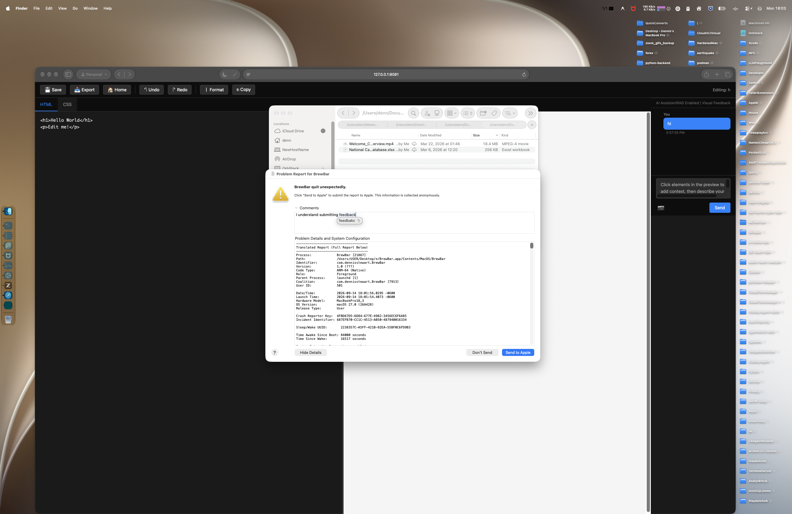

# BrewBar

BrewBar is the ultimate macOS-native GUI for Homebrew, bringing the power of the terminal into a beautiful, spatial, and hyper-integrated graphical experience. Built with pure Swift 6 and SwiftUI, BrewBar looks and feels exactly like an app that Apple built themselves.

## Features & Improvements

BrewBar bridges the gap between CLI power-users and Mac aesthetics with incredible features:

1. **Native Spatial Design:** Uses the Liquid Glass materials, dynamic SF Symbols and hover effects available on macOS 26.
2. **Deep Spotlight Integration:** CoreSpotlight securely indexes your locally installed formulas so you can find and launch them instantly from your Mac's native Cmd+Space search bar. Deep-linking seamlessly opens BrewBar straight to the package details.
3. **SwiftData History Manager:** Every single `brew install`, `upgrade`, or `uninstall` is permanently tracked via an ultra-fast, local-first SwiftData `@Model`. View timeline history and expand entries to read exactly what happened in the terminal.
4. **Rich Metadata & Terminal Fallbacks:** Fetches rich GitHub Publisher details and "Last Updated" dates instantly. Includes a built-in terminal parser that extracts the `man` or `--help` pages of any package directly into a native scroll view!
5. **Debounced Semantic Search:** Typing into the search bar intelligently debounces requests (300ms) to ensure lightning-fast UI responsiveness without aggressively triggering the Homebrew API.
6. **Smart Menu Bar Resiliency:** A native Menu Bar drop-down lets you check for updates, upgrade all packages, or quickly bring the main window into focus from anywhere.
7. **Maintenance at a Click:** Safely run `brew doctor` or preview and execute `brew cleanup` from a dedicated Preferences pane to free up gigabytes of cached space.
8. **Vulnerability Scanning, Side by Side:** The Security tab runs `brew vulns` for your formulae and scans your global npm packages at the same time. The npm scan reads every package and nested dependency under `<brew prefix>/lib/node_modules`, checks them against OSV.dev, and groups the results by the global package that brings them in, with severity filters, fixed versions and advisory links. It reports findings only and doesn't change anything. It also checks itself on every run: if a package with known advisories comes back empty, the scan fails instead of showing a false "no vulnerabilities".

## Privacy & Security (Zero Telemetry)
BrewBar is designed for maximum security and privacy. 
* **100% Local Execution:** BrewBar acts strictly as a GUI proxy for your local `brew` binary. It does not phone home, nor does it track your installs.
* **No Telemetry:** We explicitly provide an "Opt-out of Homebrew Analytics" button that triggers `brew analytics off` to completely lock down your installation.
* **Keychain:** GitHub tokens (used *only* to increase API rate limits for fetching Stargazers and Publishers) are encrypted and stored directly in the Apple Keychain. 
* **Safe Subprocesses:** Under the hood, BrewBar runs Homebrew through `Process` with an argument array and no shell, so package names are never interpreted as shell syntax. The app itself is not sandboxed.
* **Vulnerability Lookups (Opt-in):** Both Security tab scans are off until you turn on "Allow vulnerability lookups". When they're on, package names and versions, and nothing else, are sent to OSV.dev.

## Copyright
All `.swift` source code files are copyright protected.
// Copyright © 2026 Dennis Stewart. All rights reserved.
